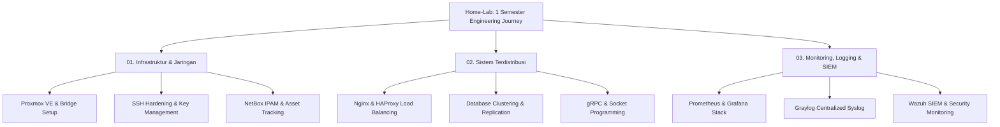

# 🛠️ Home-Lab: Infrastructure & SysAdmin Journal

This repository serves as a personal knowledge base and engineering journal, capturing a full semester of hands-on infrastructure experiments. Beyond academic coursework, it documents real-world configurations, deployment steps, and practical evaluations across System Administration, Distributed Systems, and Network Management.

---

## 🖥️ Lab Infrastructure Overview

All modules and services are hosted and tested on a **Proxmox VE Cluster** with the following node setup:

Node Specifications
VM 1 (Ubuntu Server): Containerized Workloads (Docker & Compose), Databases, & Microservices.

CT 1 (LXC Container): Gateway, Nginx Reverse Proxy, & HAProxy Load Balancer.

CT 2 (LXC Container): Automation Node, Monitoring Agents, & Centralized Logging.

Lab Modules & Documentation
Distributed Systems
1. Load-Balancing-Nginx-HAProxy — Traffic distribution and high availability failover.
2. Database-Clustering — Database replication and master-slave setup.
3. Socket-gRPC-Services — Inter-service communication using gRPC and socket programming.

Network & Infrastructure Management
1. Proxmox-Setup-Network — Proxmox VE installation, bridge setup, and IP routing.
2. SSH-Access-Hardening — SSH key authentication, config shortcuts, and security hardening.
3. NetBox-IPAM — Infrastructure IP address management and asset tracking.

Monitoring, Logging, & Security
1. Prometheus-Grafana-Stack — Infrastructure metrics collection and custom dashboards.
2. Graylog-Syslog-Pipeline — Centralized logging using Rsyslog and Graylog.
3. Wazuh-SIEM-Security — Security monitoring, log analysis, and threat detection.

